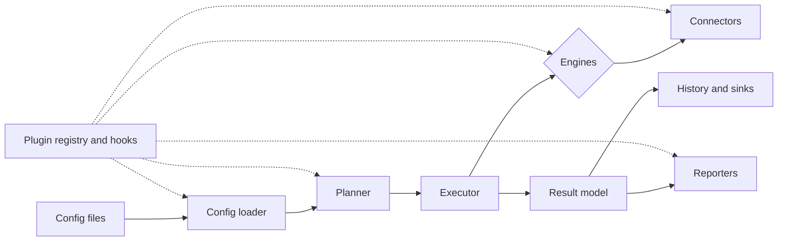
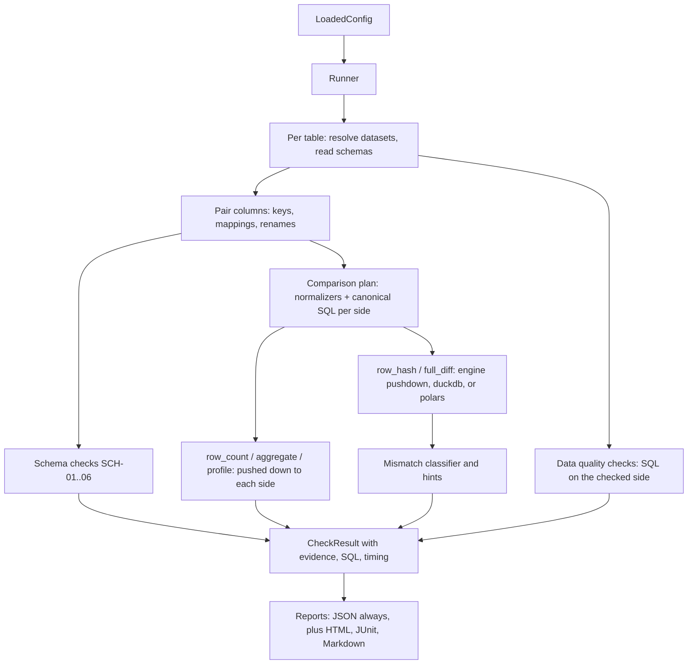

# Architecture

This document describes how `dvf` is structured, how data flows through it, and where to extend it.
Significant decisions are recorded as ADRs in [docs/adr](docs/adr/README.md). The full product specification is in [BUILD_PROMPT.md](BUILD_PROMPT.md).

## Status

| Phase | Scope | State |
|---|---|---|
| 0 | Foundations: config system, canonical types, result model, plugin registry, hooks, secrets, CLI skeleton, CI | **Done** |
| 1 | Local MVP: DuckDB, SQLite, PostgreSQL, files; core checks and comparisons; JSON, HTML, JUnit, Markdown reports | **Done** |
| 2 | Scale and debugging: bucketed hashing, bisection, parallel executor, explain/trace/debug, history, waivers at run time | Next |
| 3 | Spark, lakehouse formats, NoSQL, SAP, migration validations, discovery and mapping import | Planned |
| 4 | Integrations, containers, docs site, 1.0 release | Planned |

Phase 1 executes configurations end to end on the local machine. The execution model is recorded in [ADR 0007](docs/adr/0007-phase1-execution-model.md); the mismatch classifier moved forward from Phase 2 because Phase 1's acceptance requires it.

## Design principles

1. Push computation to the data. Aggregates, counts, and hashes run inside the source and target engines; rows move only to explain a mismatch.
2. Bounded memory. No code path may require a whole table in memory.
3. Configuration first. Every built-in capability is reachable from config; Python is for extending.
4. Everything is a plugin, including built-ins. Built-ins register through the same registry third parties use.
5. One canonical result model. Every report is rendered from one versioned JSON document.
6. Read-only and safe by default. Secrets are never logged or written to reports.
7. Lightweight core. Heavy and proprietary drivers live in optional extras.

## Layers

The core domain never imports a driver or an engine. Adapters depend on the core, never the reverse.



| Layer | Package | Phase | Responsibility |
|---|---|---|---|
| Public API | `dvf.api`, `dvf.plugins`, `dvf.models` | 0 | The only supported import surface for users and plugin authors |
| CLI | `dvf.cli` | 0 | Typer application; thin wrapper over `dvf.api` |
| Configuration | `dvf.config` | 0 | File formats, layering, interpolation, inheritance, polymorphic validation, diagnostics, JSON Schema export |
| Core domain | `dvf.core` | 0 | Canonical type system, dataset and schema models, enums, errors |
| Result model | `dvf.models.results` | 0 | Versioned run, suite, dataset, and check results |
| Plugins | `dvf.plugins` | 0 | Registry, entry-point discovery, local plugin loading, pluggy hooks, built-in declarations |
| Security | `dvf.security` | 0 | Secret providers, secret references, redaction |
| Observability | `dvf.observability` | 0 | Logging configuration, JSON logs, redaction filter |
| Planning | `dvf.compare.plan`, `dvf.execution.selectors` | 1 | Column pairing (keys, mappings, renames, include and exclude), comparison plans, pattern expansion, `--only` selectors; discovery and partitioning arrive in Phases 2 and 3 |
| Execution | `dvf.execution` | 1–2 | Sequential runner with error containment, run context, query recording, hooks (Phase 1); parallel executor, checkpoints, retries (Phase 2) |
| Engines | `dvf.engines` | 1–3 | Row-level diff: `pushdown`, `duckdb`, `polars`, `auto` (Phase 1); Spark (Phase 3) |
| Connectors | `dvf.connectors` | 1–3 | DuckDB, SQLite, PostgreSQL, files (Phase 1); warehouses (Phase 2); NoSQL and SAP (Phase 3) |
| Normalization | `dvf.normalize` | 1 | Canonicalization (Python reference, SQL per dialect, Polars) and normalizers |
| Comparison | `dvf.compare` | 1–2 | Row count, aggregate, profile, row hash, full diff, mismatch classifier (Phase 1); hash bucket, bisect, sample (Phase 2) |
| Checks | `dvf.checks` | 1–3 | Schema checks SCH-01 to SCH-06 and data quality checks (Phase 1); migration checks (Phase 3) |
| Reporting | `dvf.reporting` | 1–2 | JSON, HTML, JUnit, Markdown (Phase 1); Excel, extracts, sinks (Phase 2) |
| Debugging | `dvf.debug` | 2 | Mismatch classifier, repro artifacts, row trace |
| History | `dvf.history` | 2 | Run store, baselines, waivers |

## Configuration pipeline

`dvf.config.loader.load_config` turns files into a validated `DvfConfig`. Each stage records diagnostics with file, line, and column where the format allows it.

1. **Read** the main file (YAML, JSON, TOML, `.properties`, or `.ini`) and record the source location of every value.
2. **Extend**: merge files listed in `extends:` beneath the main file, recursively, with cycle detection.
3. **Profile**: merge `profiles.<name>` from the file, then a sibling `<stem>.<profile>.<ext>` file.
4. **Local override**: merge a git-ignored sibling `<stem>.local.<ext>` if present.
5. **Environment**: merge `DVF__SECTION__KEY=value` variables.
6. **CLI**: merge `--set path=value` overrides.
7. **Plugins**: import local plugin paths and modules named in `plugins:` or on the command line.
8. **Interpolate** `${env:NAME}`, `${env:NAME:-default}`, `${var:name}`, and `${secret:provider:reference}`. `${run.*}` placeholders are kept for run time.
9. **Inherit**: resolve `defaults` into each suite, and suite defaults into each table, so every table carries its effective settings.
10. **Validate polymorphic sections**: each connection, check, and notification is validated by the config model registered for its `type`.
11. **Validate** the root model with Pydantic.
12. **Cross-reference**: connection references, duplicate names, waivers, and component names (normalizers, comparators, reporters, engines).
13. **Hooks**: call `on_config_loaded`.

Lists replace lists when layers merge; mappings merge key by key.

## Plugin system

The registry stores entries of a given kind: `connector`, `check`, `comparator`, `normalizer`, `reporter`, `notifier`, `secret_provider`, `engine`, `sink`.

- **Built-in declarations.** Built-in components that are not implemented yet are *declared*: their names, descriptions, and config models are registered so configurations validate and the JSON Schema is complete. An entry is *ready* once an implementation class is attached; `dvf plugins list` shows which is which.
- **Entry points.** Installed packages contribute components through the groups `dvf.connectors`, `dvf.checks`, `dvf.comparators`, `dvf.normalizers`, `dvf.reporters`, `dvf.notifiers`, `dvf.secret_providers`, `dvf.engines`, and `dvf.sinks`. Hooks use `dvf.hooks`.
- **Local plugins.** A project can load Python files or folders through `plugins.paths`, or modules through `plugins.modules`. Decorators such as `@register_check("acme.vat_number_valid")` register components on import.
- **Compatibility.** A plugin may declare `dvf_plugin_api = ">=0.1,<0.2"`. The registry refuses incompatible plugins and reports why.
- **Failure isolation.** A broken third-party plugin is recorded as a load failure and reported; it does not stop other plugins from loading.

## Result model

`RunResult` → `SuiteResult` → `DatasetPairResult` → `CheckResult`, defined in `dvf.models.results` and exported as JSON Schema in [schemas/results.schema.json](schemas/results.schema.json). The schema version is independent of the package version and follows SemVer. Every reporter in Phase 1 onward renders from this model.

## Execution flow (Phase 1)



1. **Pairing.** `pair_columns` matches source and target columns using key mappings, explicit `columns.mappings` (including `source_expr` derivations), and name matching (`exact` or `case_insensitive`), honoring `include` and `exclude`. Schema checks and comparisons share it, so a renamed column is never reported as missing.
2. **Canonicalization.** Each paired column gets a canonical form chosen from both sides' types (`resolve_pair`), rendered as SQL in each side's dialect. The Python reference in `dvf.normalize.canonical` defines the rules; parity tests hold every implementation to it.
3. **Comparisons** escalate: strategies run in order, and `on_mismatch` runs only when one fails. Counts, control totals, and profiles are pushed down to each database. Row-level strategies hand a projection of each side to the configured engine.
4. **Error containment.** Each check runs in an error boundary; failures become `error` results with hints and redacted tracebacks, and the run continues. Results JSON is always written, and every other report renders from it.

## Canonical type system

`dvf.core.types` defines `CanonicalType` (logical type plus width, precision, scale, length, Unicode, nesting) and a compatibility classifier with five outcomes: `exact`, `compatible_widening`, `lossy`, `incompatible`, and `unknown`. Native type strings are parsed per dialect with sqlglot, with dialect-specific corrections (for example Oracle `DATE` carries a time component). SAP ABAP dictionary types are mapped separately.

## Security

- Secrets are referenced, never written inline: `${secret:env:NAME}`, `${secret:dotenv:NAME}`, with cloud providers declared for later phases.
- Every resolved secret value is added to a process-wide redactor. The logging filter and `dvf config show` scrub registered values and any field whose name suggests a credential.
- `dvf validate-config` does not fetch secrets unless `--resolve-secrets` is given, so it is safe to run in CI.

## Repository layout

```
src/dvf/          package (see the layer table)
tests/            unit/, parity/ (cross-engine canonicalization), e2e/ (seeded defects); benchmarks arrive with Phase 2
examples/         runnable configuration examples
schemas/          generated JSON Schemas for configuration and results
docs/             MkDocs site and ADRs
.github/          CI, CodeQL, Dependabot, issue and PR templates
```
