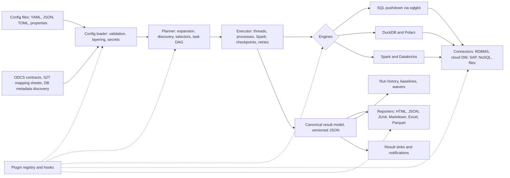

# Build prompt: data and schema validation framework for data migration and data engineering

> **How to use this file**
> Paste everything below the line into an AI coding agent such as Claude Code, or save it in the repository root and tell the agent: *"Read BUILD_PROMPT.md and execute it, starting with Phase 0."*
> It is written so the agent can work in phases, with clear acceptance criteria, rather than trying to build everything at once.
> Anything in `<angle brackets>` or listed under **Open decisions** is yours to confirm or change before the agent starts.
> Appendix A lists the requirements added from research beyond the original brief. Appendix B maps each original requirement to the section that covers it.

---

## 1. Role and mission

You are a principal Python engineer and data-platform architect with deep experience in data migration testing (SAP ECC/S/4HANA, Oracle, SQL Server, Teradata, and DB2 moving to Snowflake, Databricks, BigQuery, Redshift, Azure SQL/Fabric, PostgreSQL, and NoSQL stores) and in data engineering (PySpark, Databricks, lakehouse table formats).

Your mission is to design and build **`dvf`** (working name, "Data Validation Framework"; see Open decisions). It is an open-source, pip-installable Python framework and CLI that:

1. Validates **schemas** and **data quality** for any dataset: database tables, views, queries, NoSQL collections, files, and DataFrames.
2. **Reconciles source and target** datasets for data migrations and data pipelines, at scale (millions to billions of rows), quickly, and with exact mismatch detail.
3. Produces **complete, auditable reports**, from executive sign-off down to row and column evidence, and makes test failures **easy to debug**.
4. Is **configuration-driven** (YAML, JSON, TOML, .properties) and **extensible through plugins** (connectors, checks, comparators, normalizers, reporters, hooks), so a new migration project needs configuration, not code.
5. Runs the same way **on a laptop, in CI pipelines, inside data pipelines and orchestrators, and on Spark or Databricks clusters**.
6. Is built to evolve: stable public APIs, versioned config and result schemas, and a documented deprecation policy.

You will work in phases (section 18), keep the build green at every step, and never present stubbed functionality as complete.

---

## 2. Context and target users

| User | What they need |
|---|---|
| Migration QA and test engineers | Repeatable source-vs-target reconciliation across hundreds of tables, with defect evidence they can hand to developers |
| Data engineers | In-pipeline validation of Spark, Polars, or pandas DataFrames, with quarantine of bad rows and CI quality gates |
| Migration leads and business owners | Executive summary, sign-off report, trends across mock cutovers, and a list of waived known issues |
| Platform and DevOps teams | A Docker image, CLI exit codes, JUnit output, secrets integration, and no data leaving the environment |
| Contributors | A clear plugin API, documentation, and tests that make adding a connector or a check a small, safe change |

Typical scenarios the framework must handle:

- On-premise RDBMS to cloud data warehouse (for example SQL Server to Snowflake, Oracle to BigQuery, Teradata to Databricks).
- SAP ECC or S/4HANA to an analytics platform, or SAP to SAP (ECC to S/4HANA) with business-object reconciliation.
- SQL to NoSQL and NoSQL to SQL (for example relational orders and order lines to MongoDB documents).
- File and lakehouse pipelines (CSV or fixed-width landing files to Parquet, Delta, or Iceberg; Avro or JSON event data).
- Database-to-database replication and CDC validation during parallel-run and cutover windows.
- Repeated mock cutovers, where each rehearsal is compared with the previous one.

---

## 3. Guiding principles (non-negotiable)

1. **Push computation to the data.** Prefer aggregate, hash, and count queries executed inside the source and target engines. Move rows only when needed to explain a mismatch.
2. **Never require a full table in memory.** All comparison paths must be streaming, chunked, partitioned, or spill-to-disk.
3. **Correctness before speed, and both are measured.** Cross-engine canonicalization must produce identical hashes for identical logical values, and this is proven by parity tests (section 16).
4. **Configuration first, code second.** Every built-in capability is reachable from config. Python is for extending, not for routine use.
5. **Everything is a plugin, including built-ins.** Built-in connectors, checks, and reporters register through the same registry that third parties use.
6. **One canonical result model.** Every report format is rendered from a single versioned JSON result document.
7. **Read-only and safe by default.** Never write to source or target unless explicitly configured to use a scratch schema. Throttle load on production sources.
8. **Explain every failure.** Each failed check carries enough evidence to reproduce and diagnose it without re-running the whole suite.
9. **A lightweight core.** Heavy or proprietary drivers live in optional extras. `pip install dvf` alone must run local files, DuckDB, and SQLite end to end.
10. **Cross-platform.** Windows, macOS, and Linux are all supported. No bash-only tooling is required for development or use.

---

## 4. Scope: sources, targets, formats, and engines

### 4.1 Connector matrix (all behind one `Connector` interface)

| Category | Systems (initial priority in **bold**) | Suggested Python libraries |
|---|---|---|
| Embedded and local | **DuckDB**, **SQLite** | `duckdb`, `sqlite3` |
| RDBMS | **PostgreSQL**, **SQL Server / Azure SQL / Synapse / Fabric SQL**, **Oracle**, **MySQL / MariaDB**, DB2, Teradata, SAP ASE | `psycopg` (v3), `pyodbc` or `mssql-python`, `oracledb`, `mysql-connector-python` or `PyMySQL`, `ibm_db`, `teradatasql` |
| Cloud data warehouses | **Snowflake**, **Databricks SQL**, **BigQuery**, Redshift | `snowflake-connector-python`, `databricks-sql-connector`, `google-cloud-bigquery`, `redshift_connector` |
| Spark and lakehouse | **PySpark (local, Databricks, EMR, Dataproc, Fabric)**, Delta Lake, Apache Iceberg, Hudi (through Spark) | `pyspark`, `databricks-connect`, `deltalake`, `pyiceberg` |
| SAP | **SAP HANA (database level)**, SAP RFC (ECC/S/4 application level), SAP extracts (ODP, SLT, Datasphere, BW exports as files) | `hdbcli`, `sqlalchemy-hana`; a pluggable RFC backend (see 7.5) |
| NoSQL | **MongoDB**, Cassandra, DynamoDB, Azure Cosmos DB, Elasticsearch/OpenSearch (optional) | `pymongo`, `cassandra-driver`, `boto3`, `azure-cosmos` |
| Files | **CSV/TSV**, **Parquet**, **JSON/NDJSON**, **Avro**, ORC, Excel, XML, fixed-width | `pyarrow`, `polars`, `duckdb`, `fastavro`, `openpyxl` |
| Storage | **Local**, **S3**, **ADLS Gen2**, **GCS**, HDFS, SFTP (optional) | `fsspec`, `s3fs`, `adlfs`, `gcsfs`, `pyarrow.fs` |
| In-process DataFrames | **pandas**, **Polars**, **PySpark** DataFrames passed through the Python API | native |
| Generic | Any SQLAlchemy URL, any ODBC DSN, any ADBC driver, an Arrow Flight SQL endpoint | `sqlalchemy`, `pyodbc`, `adbc-driver-*` |

A connector declares **capabilities** so the planner can pick the best strategy: `supports_sql`, `dialect` (a sqlglot dialect name), `supports_pushdown_aggregates`, `hash_functions` (for example `md5`, `sha256`, `farm_fingerprint`, `xxhash64`), `supports_arrow_fetch`, `supports_server_side_cursor`, `supports_time_travel`, `supports_constraints_metadata`, `max_parallel_queries`, and `nested_types`.

### 4.2 Execution engines

| Engine | When it is used |
|---|---|
| **SQL pushdown** | Counts, aggregates, profiles, bucket checksums, and same-database join-diffs, generated per dialect with **sqlglot** (Ibis may be used where it simplifies multi-backend expression building; record the decision in an ADR) |
| **DuckDB** | Local, out-of-core comparison of fetched Arrow data and files; the zero-setup default |
| **Polars (lazy/streaming)** | Local DataFrame-native comparison and in-pipeline validation |
| **Spark** | Distributed comparison for very large data, Databricks jobs, and lakehouse tables |
| **Plugin executors (roadmap)** | Ray or Dask |

The `auto` engine selects by connector capabilities, data location, and size thresholds, and this is configurable per suite or table.

---

## 5. Architecture

### 5.1 Layers (hexagonal: ports and adapters)



The core domain (datasets, schemas, canonical types, checks, results) must not import any driver or engine. Adapters depend on the core, never the reverse.

### 5.2 Key abstractions (illustrative; refine in ADRs)

```python
# Core interfaces. All are registered through the plugin registry.


class Connector(Protocol):
    name: str
    capabilities: ConnectorCapabilities

    def open(self) -> None: ...
    def close(self) -> None: ...
    def test_connection(self) -> ConnectionReport: ...
    def list_datasets(self, pattern: str | None = None) -> list[DatasetRef]: ...
    def get_schema(self, ref: DatasetRef) -> DatasetSchema: ...  # canonical types
    def get_constraints(self, ref: DatasetRef) -> Constraints: ...  # PK/UK/FK/check, if available
    def run_query(self, query: QuerySpec) -> pa.RecordBatchReader: ...  # Arrow streaming
    def pushdown(self, plan: PushdownPlan) -> pa.Table: ...  # aggregates, bucket hashes


class Normalizer(ABC):  # one logical transform, three implementations
    name: ClassVar[str]

    def to_sql(self, expr: sqlglot.Expression, dialect: str) -> sqlglot.Expression: ...
    def to_polars(self, expr: pl.Expr) -> pl.Expr: ...
    def to_spark(self, col: "Column") -> "Column": ...


class Check(ABC):
    type_name: ClassVar[str]  # for example "not_null", "acme.vat_valid"
    config_model: ClassVar[type[CheckConfig]]  # Pydantic model; feeds the JSON Schema
    dimension: ClassVar[Dimension]  # completeness, uniqueness, validity, ...

    def plan(self, ctx: PlanContext) -> list[Task]: ...
    def evaluate(self, ctx: EvalContext) -> CheckResult: ...


class Comparator(ABC):  # row_count, aggregate, hash_bucket, bisect, full_diff, sample, ...
    strategy: ClassVar[str]

    def compare(self, ctx: CompareContext) -> ComparisonResult: ...


class Reporter(ABC):
    format: ClassVar[str]

    def render(self, run: RunResult, out_dir: Path, options: ReportOptions) -> list[Artifact]: ...


class SecretProvider(ABC):
    scheme: ClassVar[str]  # env, keyring, azurekv, awssm, gcpsm, vault, dbsecrets

    def resolve(self, reference: str) -> SecretStr: ...
```

### 5.3 Canonical result model (versioned JSON Schema)

`RunResult` contains `SuiteResult[]`, which contains `DatasetPairResult[]`, which contains `CheckResult[]`.

Each `CheckResult` must include at least:

- **Identity:** a stable `check_id` (deterministic, such as `suite.table.check_type[.column][.name]`), name, type, dimension, severity, tags, and owner.
- **Outcome:** `status` (`passed`, `failed`, `warning`, `error`, `skipped`, `waived`), observed value, expected value or threshold, `unexpected_count`, `total_count`, `unexpected_pct`, and the `mostly` threshold.
- **Evidence:** masked sample rows (side by side for comparisons), per-column mismatch summary, mismatch classification, and links to full extracts.
- **Reproducibility:** the exact query or expression per side (dialect and SQL text), parameters, normalization pipeline, engine, partition, and row counts scanned.
- **Timing:** started, ended, and duration, broken down by source query, target query, transfer, compare, and render.
- **Errors:** type, message, a short traceback, and a remediation hint.
- **Waiver:** the waiver applied, with its reason, ticket, and expiry.
- **Custom details:** a free-form `details` and `metadata` map, filled by config or plugins and rendered by all reporters.

Results JSON is the single source of truth. `dvf report --from results.json` re-renders any format without touching data.

---

## 6. Configuration system

### 6.1 Requirements

- **Formats:** YAML (primary), JSON, TOML, `.properties`/`.ini` (for flat overrides and legacy teams), and `.env` (for local development secrets only).
- **Layering, lowest to highest precedence:** built-in defaults, project config, environment profile (`dev`, `sit`, `uat`, `prod`), local override file (git-ignored), `DVF_*` environment variables, and CLI `--set key=value`.
- **Reuse:** `extends:` or `include:` for shared fragments, suite-level defaults inherited by tables, `vars:`, and `for_each` templating over table lists.
- **Interpolation:** `${env:NAME}`, `${var:name}`, `${run.id}`, `${run.date}`, and secrets as `${secret:<provider>:<path>#<key>}`. Secret values are never written to logs, reports, or config snapshots.
- **Validation:** every config model is Pydantic v2. Export a **JSON Schema**, including plugin-contributed check types, for IDE autocomplete (`# yaml-language-server: $schema=...`). Errors must report file, line, and column, plus a "did you mean" suggestion.
- **Versioning:** a top-level `version:` field, plus `dvf config migrate` to upgrade old configs.
- **Generation:**
  - `dvf init` scaffolds a project.
  - `dvf discover` introspects source and target metadata and generates table and column mappings. It matches names exactly, then case-insensitively, then fuzzily, checks type compatibility, and detects primary keys.
  - `dvf import-mapping` converts a source-to-target (S2T) mapping spreadsheet (Excel or CSV) into config.
  - `dvf import-contract` converts an **ODCS v3** data contract into schema and quality checks.
- **Selectors:** run subsets by suite, table glob, check type, tag, severity, or `--failed-from <run_id>`.

### 6.2 Illustrative config (finalize the real schema in Phase 0)

```yaml
# yaml-language-server: $schema=./.dvf/config.schema.json
version: 1
project:
  name: ecc-to-snowflake-finance
  description: SAP ECC 6.0 to Snowflake finance data migration
  metadata: { release: "R2", owner: "migration-qa" }      # flows into every report

defaults:
  engine: auto                  # auto | pushdown | duckdb | polars | spark
  severity: error
  sample_size: 50               # failing rows captured per check (masked)
  privacy: { mask_pii: true, mode: standard }             # standard | strict (no raw values in reports)
  normalization:
    trim: rtrim                 # none | rtrim | both
    case_sensitive: true
    null_equals_empty: false
    unicode_form: NFC
    timestamp_precision: ms
    timezone: UTC
    float_compare: { rel_tol: 1.0e-9 }
  execution: { max_parallel_tables: 4, max_queries_per_connection: 2, query_timeout_s: 1800 }

connections:
  sap_hana:
    type: sap_hana
    host: ${env:SAP_HANA_HOST}
    port: 30015
    user: ${env:SAP_HANA_USER}
    password: ${secret:azurekv:migration-kv#sap-hana-password}
    options: { schema: SAPSR3, client: "100" }
  snowflake:
    type: snowflake
    account: ${env:SF_ACCOUNT}
    user: ${env:SF_USER}
    authenticator: externalbrowser
    options: { warehouse: QA_WH, database: ANALYTICS, role: QA_READONLY }

suites:
  - name: finance_master_data
    source: sap_hana
    target: snowflake
    tags: [master-data, nightly]
    tables:
      - name: customers
        source: { table: KNA1, filter: "MANDT = '100' AND LOEVM = ''" }
        target: { table: CORE.CUSTOMER }
        keys:
          - { source: KUNNR, target: CUSTOMER_ID, normalize: [sap_alpha] }
        columns:
          include: "*"
          exclude: [MANDT]
          mappings:
            - { source: NAME1, target: CUSTOMER_NAME }
            - { source: ERDAT, target: CREATED_DATE, normalize: [sap_dats] }
            - { source_expr: "TRIM(STRAS) || ' ' || TRIM(ORT01)", target: FULL_ADDRESS }
        schema_checks: [columns_present, type_compatibility, length_precision, nullability]
        comparison:
          strategies: [row_count, aggregate, hash_bucket]   # escalate: count -> aggregate -> hash -> diff
          buckets: 1024
          on_mismatch: full_diff                            # fetch only mismatched buckets
          tolerance: { numeric_abs: 0.005 }
          snapshot: { target_as_of: "${var:cutover_ts}" }   # time travel, where supported
        checks:
          - { type: not_null, columns: [CUSTOMER_ID, CUSTOMER_NAME] }
          - { type: unique, columns: [CUSTOMER_ID] }
          - { type: regex, column: COUNTRY_CODE, pattern: "^[A-Z]{2}$", mostly: 0.999 }
          - type: referential_integrity
            column: COMPANY_CODE
            parent: { table: CORE.COMPANY, column: COMPANY_CODE }
          - type: custom_sql
            name: no_future_created_dates
            side: target
            sql: "SELECT * FROM {table} WHERE CREATED_DATE > CURRENT_DATE"
            severity: warning
            details: { rule_owner: "finance-ba", requirement: "FIN-REQ-112" }
          - { type: acme.vat_number_valid, column: VAT_ID }   # plugin check

      - pattern: { source: "SAPSR3.ZFI_*", target: "CORE.ZFI_*" }   # many tables from one template, paired by name
        keys: auto                           # discover primary keys
        comparison: { strategies: [row_count, aggregate] }

waivers:
  - check: finance_master_data.customers.compare.column_mismatch
    column: CUSTOMER_NAME
    reason: "Names longer than 35 characters are truncated by design"
    ticket: CR-1042
    expires: 2027-01-31

reports:
  formats: [html, json, junit, markdown, excel]
  output_dir: ./reports/${run.date}/${run.id}
  branding: { title: "Finance migration - mock cutover 3", logo: ./assets/logo.png }
  extracts: { format: parquet, max_rows_per_check: 100000 }

history: { store: "duckdb:///./.dvf/history.duckdb", baseline: last_passed }
notifications:
  - { type: teams, webhook: "${secret:env:TEAMS_WEBHOOK}", on: [failed, error] }
```

---

## 7. Validation catalog

Every item below is a built-in, configurable check or comparison with a stable type name, unit tests, and generated documentation. IDs are for traceability in docs and tests.

### 7.1 Schema validations

| ID | Validation | Notes |
|---|---|---|
| SCH-01 | Object existence | Every in-scope source object has a target; unexpected extra target objects are reported |
| SCH-02 | Column presence | Missing and extra columns, aware of configured renames and mappings |
| SCH-03 | Type compatibility | Through a **canonical type system** with per-dialect mappings; each pair is classified as `exact`, `compatible_widening` (INT to BIGINT, VARCHAR(10) to VARCHAR(20)), `lossy` (DECIMAL(18,4) to DECIMAL(18,2), TIMESTAMP(9) to TIMESTAMP(3), VARCHAR(50) to VARCHAR(20)), or `incompatible` |
| SCH-04 | Length, precision, scale | Truncation risk; BYTE vs CHAR semantics (Oracle); VARCHAR vs NVARCHAR; Unicode capacity |
| SCH-05 | Nullability and defaults | Nullability changes and default-value differences |
| SCH-06 | Constraints | PK, UK, FK, and check constraints. Where the target does not enforce constraints (Snowflake, BigQuery, Databricks), **automatically convert them into data checks** (uniqueness, RI) |
| SCH-07 | Physical design (informational) | Indexes, partitioning, clustering, distribution and sort keys |
| SCH-08 | Column order | Optional, off by default |
| SCH-09 | Collation, case sensitivity, character set | Encoding and collation differences that change comparison semantics |
| SCH-10 | Object inventory | Counts and names of views, procedures, functions, triggers, sequences, and synonyms (informational) |
| SCH-11 | Schema drift | Compared against a baseline snapshot (previous run or a committed schema file) |
| SCH-12 | Contract conformance | Dataset vs an ODCS contract or expected-schema file |
| SCH-13 | Semi-structured and nested schema | Inferred document schema, field presence %, type heterogeneity, structs and arrays, Avro and Parquet logical types, Avro backward and forward compatibility |
| SCH-14 | Naming standards | Regex rules for target naming conventions |

### 7.2 Data quality checks (grouped by DQ dimension)

| Dimension | Checks |
|---|---|
| Completeness | `not_null`, `not_blank`, `null_ratio` threshold, `required_if` (conditional), fill-rate comparison between source and target, mandatory-field completeness per record |
| Uniqueness | `unique` (single or composite), full-row duplicates, duplicates ignoring case and whitespace, fuzzy duplicates (plugin) |
| Validity | `regex`, `allowed_values`, `reference_lookup` (domain table), `range`, `length`, `castable_to` (strings holding numbers or dates), format validators (email, phone, postal code, IBAN, UUID, ISO country, currency, language codes), date validity and sentinel dates (`0000-00-00`, `9999-12-31`, SAP `00000000`), control and non-printable characters, encoding validity (no U+FFFD or mojibake patterns) |
| Consistency | Cross-column rules (`end_date >= start_date`), cross-table rules, balance rules (debits = credits per document), conditional rules, unit and currency consistency |
| Referential integrity | Orphan detection (child to parent, within or across connections), cardinality (1:1, 1:N), key-map completeness |
| Accuracy | Source-vs-target reconciliation (7.3), comparison with golden or reference data, recomputed derived fields |
| Timeliness | Freshness (`max(updated_at)` within SLA), partition arrival, load-timestamp sanity |
| Volume | Row count in range, partition-level counts, anomaly against run history |
| Distribution | Mean, standard deviation, and quantiles within tolerance vs source or baseline; top-N frequency comparison; cardinality comparison; KS test or PSI drift (optional extra) |
| Special types | JSON validity, XML well-formedness, LOB and binary checksums, geospatial validity (plugin) |
| Custom | `custom_sql` (returns failing rows or a scalar to assert), `expression` (SQL boolean or Polars expression), Python plugin checks |

All row-level checks support `mostly` (pass if at least X% of rows satisfy the check), `severity`, `where` filters, `tags`, `details`, and the actions `fail`, `warn`, `drop`, and `quarantine` (the last two in in-pipeline mode, section 12.3).

### 7.3 Source-vs-target reconciliation and comparison

| ID | Comparison | Description |
|---|---|---|
| REC-01 | Row counts | Total, filtered, and grouped (by partition, date, company code, fiscal period, and so on) |
| REC-02 | Aggregate and control totals | Per column: sum, min, max, avg, count, count distinct, null count, sum of string lengths; overall and grouped |
| REC-03 | Key reconciliation | Missing in target, unexpected in target, duplicate keys per side, null keys |
| REC-04 | Row-hash comparison | Hash of canonicalized mapped columns per key (section 8) |
| REC-05 | Column-level diff | For mismatched rows: per-column mismatch counts and %, side-by-side samples, and classification (section 9) |
| REC-06 | Checksum bisection | For mostly identical, very large, cross-database tables: recursive segment checksums that transfer only differing segments |
| REC-07 | Statistical sample comparison | When a full comparison is too expensive: documented sample size, confidence level, stratification, and a fixed seed |
| REC-08 | Query-vs-query | Arbitrary SQL on each side (KPI and report parity, for example trial balance by company code and period) |
| REC-09 | File-vs-table and file-vs-file | Includes header and trailer control-record totals, file counts, and file checksums |
| REC-10 | Many-to-one and one-to-many | A source query with joins vs a denormalized target, or split tables |
| REC-11 | Transformation verification | `source_expr` derivations computed on the source and compared with the target column |
| REC-12 | Profile comparison | Side-by-side column profiles (null %, distinct, min, max, length stats, top values) |
| REC-13 | LOB and binary comparison | By hash, with size comparison |

Strategies are composable and escalating. Run cheap checks first (count, then aggregate, then bucket hash), and fetch row-level detail only for mismatched buckets.

### 7.4 Migration-specific validations

| ID | Validation |
|---|---|
| MIG-01 | **Scope and exclusion reconciliation:** records excluded by design (archived, closed, out of scope) are counted and reconciled against an expected-excluded count |
| MIG-02 | **Delta and incremental loads:** watermark-window comparison; CDC operation application (inserts, updates, and deletes reflected); late-arriving data |
| MIG-03 | **Idempotency:** re-running a load does not create duplicates or change counts |
| MIG-04 | **SCD Type 2:** exactly one current row per business key, no overlapping or gapped validity ranges, history-count reconciliation |
| MIG-05 | **Soft and hard deletes:** propagation and flag consistency |
| MIG-06 | **Surrogate and key maps:** every legacy key maps to exactly one new key, and the reverse where required |
| MIG-07 | **Audit and lineage columns:** load timestamp, batch ID, and source system populated and consistent |
| MIG-08 | **Mock cutover comparison:** run-to-run diff across rehearsals, plus a cutover sign-off report |
| MIG-09 | **Consistent snapshot:** `as_of` or time-travel comparison (Snowflake, Delta, Iceberg, Oracle Flashback, and others) and an in-flight exclusion window for live replication, so that moving data does not produce false mismatches |
| MIG-10 | **Character set conversion:** EBCDIC, Latin-1, or code pages to UTF-8, with round-trip of special characters |
| MIG-11 | **Precision and time zone conversion:** DATE to TIMESTAMP, local time to UTC, DST edge cases |
| MIG-12 | **Default and sentinel substitution:** rules such as `NULL` to `'N/A'` or `'00000000'` to `NULL` are verified explicitly rather than masked |
| MIG-13 | **Business parity validations:** KPI and report queries (balances, open items, inventory valuation) match between systems |
| MIG-14 | **Pre-migration baseline capture:** snapshot source metrics before migration to support post-migration comparison and go/no-go and rollback decisions |

### 7.5 SAP pack (`dvf[sap-hana]`, `dvf[sap-rfc]`)

- **Connectivity, in order of preference for volume:**
  1. SAP HANA database access through `hdbcli` or `sqlalchemy-hana`, where licensing permits, so aggregates and hashes are pushed down.
  2. Extracted files (ODP, SLT, Datasphere, or BW exports to Parquet or CSV).
  3. RFC application-level access.
- **RFC backend is pluggable.** PyRFC is no longer maintained (SAP Community, January 2026) and has no official replacement. Define an `SapRfcBackend` interface with adapters for PyRFC (legacy), a direct NW RFC SDK binding, a custom Z read function module, and OData or CDS views. Document that `RFC_READ_TABLE` has a 512-byte row buffer (`DATA_BUFFER_EXCEEDED` on wide tables). Mitigate with field chunking, paging, or a custom read module, and prefer database-level access.
- **DDIC schema extraction:** tables (DD02L), fields (DD03L), data elements (DD04L and DD04T), and foreign keys (DD05S and DD08L) mapped to canonical types.
- **SAP normalizers (all with SQL, Polars, and Spark implementations):**
  - `sap_alpha`: ALPHA conversion exit, padding or stripping leading zeros on keys such as MATNR, KUNNR, LIFNR, and AUFNR.
  - `sap_matnr_length`: MATNR length change from 18 to 40 characters in S/4HANA.
  - `sap_dats` and `sap_tims`: `00000000`, blank, and `000000` to NULL; `YYYYMMDD` to DATE.
  - `sap_bool`: `'X'` and `' '` to true and false.
  - `sap_curr`: currency-dependent decimal shift using TCURX (default 2 decimals, for example JPY with 0, and some currencies with 3).
  - `sap_quan`: unit reference.
  - `sap_numc`, CHAR trailing-space handling, and `sap_spras` (1-character internal to 2-character ISO language key using T002).
  - MANDT client filtering applied automatically.
- **Business object templates:** customer and vendor to Business Partner (CVI) mapping counts; GL balances and trial balance per company code and fiscal period; open items; material master by plant and sales organization.
- **Licensing:** never bundle proprietary SAP drivers or the NW RFC SDK. Users install them, and the docs explain how.

### 7.6 NoSQL pack

- MongoDB, Cassandra, DynamoDB, and Cosmos DB connectors (Elasticsearch optional).
- **Document flattening** with a configurable path mapping (dot paths). Array strategies: `explode`, `index`, or `hash` as canonical JSON with sorted keys.
- **Schema inference** by sampling, reporting field presence % and type distribution per path.
- **SQL to and from NoSQL comparison:** relational parent and child tables vs embedded documents, compared through per-key child counts, sums, and canonical sub-document hashes.
- Handling of ObjectId, UUID, Decimal128, and BSON dates; configurable read preference and consistency level.

### 7.7 File and lakehouse pack

- CSV and TSV (dialect, encoding, header, quoting, bad-line policy), fixed-width (layout spec), JSON and NDJSON, XML, Excel, Parquet, Avro, ORC, Delta, Iceberg, and Hudi (through Spark); compressed files (gzip, zstd, snappy, bz2); Hive-style partitioned datasets.
- **File-level checks:** existence, count, naming pattern, size, checksum (MD5 or SHA-256), freshness, header and trailer control-record reconciliation, schema-on-read vs expected schema, corrupt or unreadable record counts with a bad-records extract, and delimiter or quoting errors.

---

## 8. Comparison engine and performance

### 8.1 Canonicalization (the correctness foundation)

Before hashing or comparing, each mapped column is converted to a **canonical representation**. The same normalizer must give identical output in every SQL dialect, in Polars, and in Spark.

| Logical type | Canonical form |
|---|---|
| NULL | A distinct sentinel, never equal to an empty string unless `null_equals_empty` |
| String | Optional `rtrim` or `trim`, case folding, Unicode NFC, optional whitespace collapse |
| Integer | Base-10, no leading zeros |
| Decimal | Fixed scale (configured, or the maximum of the two sides), no exponent, `-0` becomes `0` |
| Float | Not hashed by default; compared separately with absolute or relative tolerance, or rounded to N significant digits when configured |
| Boolean | `1` or `0` |
| Date and timestamp | ISO-8601; timestamps converted to UTC and truncated to the configured precision |
| Binary | Hex digest |
| JSON and documents | Canonical JSON with sorted keys and normalized numbers |

Row serialization uses length-prefixed fields with an unambiguous separator, so `("ab","c")` never collides with `("a","bc")`.

### 8.2 Hashing and bucketed comparison

- Use a database-native hash when **both** sides support the same function on identical canonical strings (MD5 is the most portable; SHA-256 or FARM_FINGERPRINT where both sides match). Otherwise fetch the canonical columns as Arrow and hash on the client with **xxh3-128**.
- **Bucket checksums:** `bucket = hash(key) mod N`. For each bucket, push down `COUNT(*)` and an order-independent aggregate of row hashes, such as `SUM` of a 64-bit hash prefix mod 2^64. **Do not use XOR**, because duplicate rows cancel out. Compare the buckets, then drill into mismatched buckets only.
- **Bisection (REC-06):** for mostly identical tables, use recursive key-range checksums with a configurable threshold below which rows are downloaded and diffed locally. This is the approach implemented by reladiff, the maintained fork of data-diff.
- **Same-database fast path:** when source and target share an engine and connection, generate a single in-database `FULL OUTER JOIN` diff, and optionally materialize the result to a scratch table.

### 8.3 Partitioning, parallelism, and data movement

- Partition by primary-key ranges, hash buckets, date partitions, or user-defined predicates (`dvf plan --partitions` previews them).
- A task DAG with concurrency at the suite, table, and partition levels, and **per-connection concurrency caps** to protect production sources.
- Arrow end to end: ADBC, ConnectorX, or driver-native Arrow fetch where available; otherwise server-side cursors with a tuned fetch size.
- Local engine: DuckDB with spill-to-disk for larger-than-memory comparisons, and Polars streaming for DataFrame paths.
- Spark engine: partition-aligned joins on keys, salting for skewed keys, and adaptive query execution enabled.
- Process pool for CPU-bound client-side hashing; threads or async for I/O.

### 8.4 Robustness

Retries with exponential backoff on transient errors, per-query timeouts, **checkpointing per partition**, `dvf run --resume <run_id>`, and partial results always written, so a report exists even if a run is interrupted.

### 8.5 Performance targets (verify with committed benchmarks)

- **Pushdown counts and aggregates:** bounded by database execution time, with no row transfer.
- **Local:** a full row-level comparison of 10 million rows by 30 columns (Parquet to Parquet, or DuckDB, on a 16 GB laptop) completes in **under 2 minutes**, with memory bounded by configuration.
- **Cross-database, mostly identical tables:** rows transferred scale with the number of differences (roughly O(d log n)), not with table size.
- **Spark:** near-linear scale-out to billions of rows through bucket partitioning.
- **Benchmarks:** live in `tests/benchmarks` with synthetic data generators. CI tracks regressions, and a slowdown of more than 15% fails the benchmark job.

---

## 9. Debugging and failure triage

1. **Complete evidence per failure:** what was asserted, observed vs expected, where (table, partition, column, key), the evidence (masked side-by-side samples), how (exact SQL or expressions per side, normalization pipeline, engine, parameters), and when (timings).
2. **Mismatch classifier with hints.** Automatically label each column mismatch as one of: whitespace-only, case-only, leading zeros, numeric rounding within N decimals, precision or scale truncation, string truncation (target is a prefix of source), time zone shift (difference of exactly N hours), date-format difference, NULL vs empty, default or sentinel substitution, encoding or mojibake, or type coercion. Aggregate the labels per column and suggest a fix, for example *"98% of mismatches are trailing spaces; consider `trim: rtrim` or fix the CHAR to VARCHAR mapping."*
3. **Repro artifacts per failed check:** `repro/<check_id>.source.sql` and `.target.sql`, a minimal single-check config, and mismatch extracts as Parquet or CSV.
4. **Row trace:** `dvf trace --table customers --key 0000012345` fetches the record from both sides and shows raw values, the value after each normalization step, and the hash on each side.
5. **CLI tools:**
   - `dvf explain` shows the plan and generated SQL without executing.
   - `dvf run --only <selector>` runs a subset.
   - `dvf rerun --failed <run_id>` re-runs failed checks.
   - `dvf debug <run_id> <check_id>` opens a detailed drill-down.
   - `--log-level debug` and `--keep-temp` add detail and keep intermediate files.
6. **Notebook helper:** `dvf.debug.load(run_id).check(check_id).mismatches()` returns a DataFrame.
7. **Run-to-run diff:** new, resolved, and persisting failures relative to the previous run or a baseline.
8. **Structured logs** correlated by `run_id`, `check_id`, and `partition`, with a JSON log option for CI and log platforms.
9. **Optional AI-assisted triage plugin interface (off by default):** it may receive only masked, aggregated mismatch summaries, and only after explicit opt-in.

---

## 10. Reporting

### 10.1 Formats

| Format | Audience and purpose |
|---|---|
| **HTML** | Engineers and QA. A single self-contained offline file (no CDN). Interactive filter, sort, and search; collapsible drill-downs; charts; links to extracts |
| **JSON** | The canonical versioned results document; every other format derives from it |
| **JUnit XML** | CI test tabs; each check is a test case and each suite a test suite |
| **Markdown** | PR comments and `$GITHUB_STEP_SUMMARY`; a compact summary with the top failures |
| **Excel (.xlsx)** | Business sign-off: summary, per-table, schema diff, mismatches, waivers, and sign-off sheets |
| **CSV and Parquet extracts** | Full mismatch and failing-row details for analysis |
| **PDF (optional)** | Audit evidence, rendered from HTML |
| **Result sinks** | Write runs and check results to DuckDB, SQLite, PostgreSQL, Snowflake, or Delta tables for dashboards (Power BI, Tableau, Superset, Grafana) |

### 10.2 Required content

- **Executive summary:** overall status, quality score, counts by status (pass, warn, fail, error, skipped, waived), tables in scope, rows compared, duration, throughput, and the top 10 issues.
- **Per-table scorecard:** DQ dimension scores; source, target, and difference row counts; matched, missing, extra, mismatched, and duplicate counts; and match %.
- **Schema diff:** column by column, with the compatibility classification.
- **Column mismatch matrix:** per column, the mismatch count, %, classification breakdown, and side-by-side samples.
- **Profile comparison:** source and target profiles side by side.
- **Check details:** every field of every `CheckResult`, including custom `details` and `metadata`.
- **Waivers:** those applied, with reason, ticket, and expiry; **expired waivers are flagged as failures**.
- **Trends:** comparison with previous runs or the baseline, and new vs resolved failures.
- **Reproducibility:** run ID, framework and plugin versions, config hash and redacted snapshot, git SHA, host, engine and driver versions, CLI arguments, environment profile, and a timing breakdown.

### 10.3 Customization and scale

- Jinja2 template overrides per section, branding (title, logo, colors), field selection, and custom sections contributed by plugins (`report_sections` hook).
- Custom reporters through entry points.
- Project and run metadata injection (release, approver, environment).
- Cap samples, paginate large tables, offload large details to linked Parquet files, and stream rendering so report generation never loads all results into memory.

---

## 11. Extensibility and customization

### 11.1 Three customization tiers

1. **Config only:** `custom_sql`, `expression` checks, thresholds, severities, tolerances, normalizers per column, report templates, and custom `details`.
2. **Project-local Python:** a `plugins/` folder (or a `--plugins` module path) auto-loaded at run time. Decorators register checks, normalizers, comparators, and reporters.
3. **Installable packages:** Python **entry points**, so organizations can publish `dvf-acme-checks` internally or on PyPI.

```python
from dvf.plugins import register_check, RowCheck, CheckConfig


@register_check("acme.vat_number_valid")
class VatNumberValid(RowCheck):
    class Config(CheckConfig):
        column: str
        country_column: str | None = None

    def predicate(self, ctx):  # returns an engine-agnostic boolean expression
        return ctx.expr.call("acme_vat_valid", ctx.col(self.config.column))
```

```toml
# pyproject.toml of a plugin package
[project.entry-points."dvf.checks"]
vat_number_valid = "dvf_acme.checks:VatNumberValid"
```

### 11.2 Entry point groups

`dvf.connectors`, `dvf.checks`, `dvf.comparators`, `dvf.normalizers`, `dvf.reporters`, `dvf.sinks`, `dvf.notifiers`, `dvf.secret_providers`, `dvf.engines`, `dvf.hooks`.

### 11.3 Lifecycle hooks (pluggy hookspecs)

`on_config_loaded`, `modify_plan`, `on_run_start`, `on_suite_start`, `on_check_start`, `on_check_complete`, `on_failure`, `on_suite_end`, `on_run_end`, `report_sections`, `enrich_result`. Use these to add custom details, push to ticketing systems, or alter plans.

### 11.4 Stability guarantees

- The public API is limited to `dvf.api`, `dvf.plugins`, and `dvf.models`. Internal modules are private.
- Plugins declare a compatible plugin-API range, and the registry checks it at load time.
- Plugin config models automatically extend the exported JSON Schema.
- `dvf plugin new <kind>` scaffolds a plugin package with tests.
- `dvf plugins list` shows installed plugins, versions, and capabilities.

---

## 12. Execution modes and integrations

### 12.1 CLI (Typer and Rich)

`init`, `discover`, `import-mapping`, `import-contract`, `validate-config`, `connections test`, `plan` / `explain`, `run`, `rerun`, `profile`, `suggest` (candidate checks from profiling), `schema-diff`, `compare` (ad hoc two-dataset comparison without a config file), `trace`, `debug`, `report`, `history`, `waivers list`, `plugins list`, and `config migrate`.

**Exit codes:**

| Code | Meaning |
|---|---|
| `0` | Passed (warnings allowed unless `--strict`) |
| `1` | Validation failures at or above `--fail-on` severity, or a quality score below `--min-score` |
| `2` | Execution error (connection, query, or timeout) |
| `3` | Configuration or usage error |

### 12.2 Python API

`dvf.run(config_path | Config, overrides=..., selectors=...) -> RunResult`. Configs can be built programmatically with the Pydantic models, which suits notebooks and tests.

### 12.3 In-pipeline (library) mode for data engineering

```python
valid_df, quarantine_df, result = dvf.validate_dataframe(df, checks=[...], on_fail="quarantine")
```

Works for Spark, Polars, and pandas. Quarantined rows carry reason columns. This mode supports batch and Spark Structured Streaming through `foreachBatch`.

### 12.4 Local execution

- `pip install dvf` or `uv tool install dvf` works on Windows, macOS, and Linux.
- DuckDB is the zero-setup engine.
- `dvf init --example` creates a runnable sample with seeded discrepancies in under a minute.

### 12.5 Containers

Docker images on GHCR, in a **slim** variant and a **full** variant with open-source drivers. Proprietary drivers are never bundled; they are mounted or installed by the user.

### 12.6 CI/CD

- A GitHub Action (`action.yml`), plus templates for GitLab CI, Azure DevOps, and Jenkins.
- JUnit and Markdown publishing, artifact upload, and quality gates (`--fail-on`, `--min-score`).
- A **PR mode** with fast checks (counts, aggregates, samples) and a **nightly mode** with full comparisons, selected by tags.

### 12.7 Orchestrators and platforms

Examples, and where useful thin packages, for:

- Airflow (operator), Dagster (asset checks), and Prefect (tasks).
- Databricks Workflows (wheel or notebook task).
- Azure Data Factory, Synapse, and Fabric (through container or Databricks activities).
- AWS Glue and Step Functions.
- dbt (run after `dbt build`; optionally discover models from `manifest.json`).

### 12.8 Notifications

Slack, Microsoft Teams, email (SMTP), and generic webhooks. Jira or ServiceNow ticket creation as an optional plugin.

### 12.9 Metadata and interoperability

- **ODCS v3** contract import and export.
- Optional **OpenLineage** data-quality facets emission.
- Optional adapters that run existing **Great Expectations** suites, **Soda** checks, or **Pandera** schemas and merge their results into the unified report (roadmap).

---

## 13. Security, privacy, and compliance

- **Read-only by default.** Writes are allowed only to an explicitly configured scratch schema (opt-in) for temporary tables and materialized diffs.
- **Secrets:** providers for environment variables, `.env` (local only), OS keyring, Azure Key Vault, AWS Secrets Manager, GCP Secret Manager, HashiCorp Vault, and Databricks secrets. Values are redacted everywhere.
- **PII protection:**
  - Column tagging (`pii: true`) plus pattern detection (email, phone, national-ID-like values).
  - Samples are masked, hashed, or tokenized.
  - `privacy.mode: strict` emits no raw values at all.
  - Sampling can be disabled per check.
- **No telemetry and no phone-home.** No data leaves the execution environment except to configured sinks and notifiers.
- **Safe SQL:** identifiers quoted through sqlglot and literal values parameterized. Custom SQL is trusted configuration, and the docs say so clearly.
- **Least-privilege docs:** minimal grants per supported database.
- **Supply chain:** a lockfile, Dependabot or Renovate, `pip-audit`, CodeQL, a CycloneDX SBOM per release, PyPI Trusted Publishing with attestations, and an OpenSSF Scorecard badge.

---

## 14. Observability of the framework itself

- Structured logging (stdlib `logging` with a JSON formatter, or structlog), with Rich progress bars for interactive use and quiet output in CI.
- Metrics per run: rows scanned per second, bytes transferred, query times per side, and retries.
- Optional OpenTelemetry traces and metrics export (`dvf[otel]`).
- A timing breakdown in every report showing where the time went.

---

## 15. Project structure and tooling

```
dvf/
├─ src/dvf/
│  ├─ api.py                 # stable public Python API
│  ├─ models/                # public result and config models (Pydantic)
│  ├─ cli/                   # Typer app and commands
│  ├─ config/                # loaders (yaml/json/toml/properties), layering, interpolation, schema export
│  ├─ core/                  # datasets, canonical types, type mappings, severity, dimensions
│  ├─ planning/              # discovery, expansion, selectors, partitioning, task DAG
│  ├─ execution/             # executors, checkpoints, retries, throttling
│  ├─ engines/               # pushdown (sqlglot), duckdb, polars, spark
│  ├─ connectors/            # base, duckdb, sqlite, files, generic sqlalchemy/odbc/adbc; others via extras
│  ├─ normalize/             # canonicalization and normalizers (sql, polars, spark implementations)
│  ├─ compare/               # count, aggregate, hash_bucket, bisect, full_diff, sample, query_vs_query
│  ├─ checks/                # schema/, quality/, reconciliation/, migration/
│  ├─ packs/                 # sap/, nosql/, files/
│  ├─ reporting/             # json, html (jinja2), junit, markdown, excel, extracts, sinks
│  ├─ debug/                 # classifier, repro, trace
│  ├─ history/               # run store, baselines, waivers
│  ├─ plugins/               # registry, entry points, hookspecs, scaffolding
│  ├─ security/              # secrets, masking, redaction
│  └─ observability/
├─ tests/                    # unit/, parity/, integration/, e2e/, benchmarks/, fixtures/, generators/
├─ examples/                 # local_files/, postgres_to_snowflake/, sap_to_databricks/, mongodb_to_postgres/, ci/
├─ docs/                     # MkDocs Material: guides, concepts, generated config and check reference, ADRs
├─ docker/
├─ .github/                  # workflows (ci, release, docs, codeql), issue and PR templates, dependabot
├─ action.yml
├─ pyproject.toml  uv.lock  noxfile.py  .pre-commit-config.yaml
└─ README.md  LICENSE  NOTICE  CONTRIBUTING.md  CODE_OF_CONDUCT.md  SECURITY.md  CHANGELOG.md  AGENTS.md
```

### Tooling

- **Python and packaging:** Python **3.11+** (test matrix 3.11 to 3.14); `uv`; `hatchling` with `hatch-vcs` for versions from git tags.
- **Code quality:** `ruff` (lint and format); `mypy --strict` on `core`, `compare`, `normalize`, and `models`.
- **Testing:** `pytest`, `pytest-xdist`, `coverage`, `hypothesis`, `testcontainers`, `pytest-benchmark`.
- **Workflow:** `nox` for cross-platform tasks; `pre-commit`; Conventional Commits with automated changelog and release (release-please or python-semantic-release).
- **Docs:** MkDocs Material and mkdocstrings. The config reference and check catalog are generated from the Pydantic models and the registry.

### Optional extras

`postgres`, `mysql`, `mssql`, `oracle`, `db2`, `teradata`, `snowflake`, `bigquery`, `redshift`, `databricks`, `spark`, `delta`, `iceberg`, `avro`, `excel`, `mongodb`, `cassandra`, `dynamodb`, `cosmos`, `sap-hana`, `sap-rfc`, `aws`, `azure`, `gcp`, `vault`, `otel`, `stats`, `all` (open-source drivers only).

Pin compatible version ranges and test them. Fast-moving dependencies such as sqlglot, Ibis, and DuckDB need upper bounds verified in CI.

---

## 16. Testing strategy for the framework

1. **Unit tests** for every module. Coverage of at least **90%** for `core`, `normalize`, `compare`, and `checks`, and at least 80% overall.
2. **Cross-engine parity tests (critical).** For every normalizer and the row serializer and hasher, identical inputs must give identical canonical strings and hashes in DuckDB, Polars, Spark, and PostgreSQL in unit CI, and in every other dialect in integration CI. Use **Hypothesis** to generate edge cases: Unicode, NULLs, empty strings, extreme and negative-zero numbers, high-precision decimals, leap days, DST transitions, pre-1970 timestamps, and trailing spaces.
3. **Seeded-defect end-to-end harness (the acceptance backbone).** A generator creates a source dataset and a target copy with injected defects of known type and count: missing, extra, and duplicate rows, value changes, whitespace, case, rounding, truncation, time zone shift, type change, NULL substitution, encoding damage, and orphans. The report must detect **exactly** the injected defects (100% precision and recall) and classify them correctly, in every engine.
4. **Integration tests** with testcontainers (PostgreSQL, MySQL, SQL Server, Oracle Free, MongoDB). Cloud connectors use recorded contract tests, plus optional live tests gated by CI secrets.
5. **Golden-file tests:** results JSON validates against its schema, JUnit XML validates, and an HTML snapshot sanity check runs.
6. **Config tests:** every example and documentation snippet validates and runs.
7. **Benchmarks** tracked over time, with regression thresholds.
8. **CI matrix:** Windows, macOS, and Linux, across the supported Python versions.

---

## 17. Open source and distribution

- **License:** **Apache-2.0** by default (patent grant, enterprise-friendly). Add a NOTICE file and track third-party licenses.
- **Versioning:** SemVer. Deprecations emit warnings for at least one minor release before removal. Config and results schema versions are documented with migrators.
- **Release pipeline:** a git tag triggers the build (sdist and wheel), publishes to **PyPI through Trusted Publishing** with attestations, creates a GitHub Release with the changelog, pushes Docker images to GHCR, and publishes docs to GitHub Pages.
- **Community files:** CONTRIBUTING (dev setup on Windows, macOS, and Linux), CODE_OF_CONDUCT, SECURITY (vulnerability reporting), issue and PR templates, labels, good-first-issues, a plugin authoring guide, a public ROADMAP, and an ADR log.
- **README:** a 60-second quickstart, a feature matrix, a connector support table with maturity levels, architecture overview, and badges (CI, coverage, PyPI, license, docs, OpenSSF).

---

## 18. Delivery plan (build in vertical slices)

### Phase 0: Foundations

- **Build:** repository scaffolding, tooling, CI matrix, core domain models, canonical type system, plugin registry and hookspecs, config loaders, layering, interpolation, secrets (environment variables and `.env`), JSON Schema export, CLI skeleton, logging, `ARCHITECTURE.md`, and initial ADRs (engine strategy, sqlglot vs Ibis, result schema, plugin API).
- **Accept when:** `dvf --version`, `dvf validate-config examples/local_files/dvf.yaml`, and `dvf plugins list` work, and CI is green on all three operating systems.

### Phase 1: Local MVP

- **Build:**
  - Connectors: DuckDB, SQLite, PostgreSQL, and files (CSV, Parquet, JSON).
  - Engines: pushdown, DuckDB, and Polars.
  - Schema checks SCH-01 to SCH-06, and the core DQ checks (completeness, uniqueness, validity, RI, `custom_sql`, `expression`).
  - Comparisons REC-01 to REC-05 and REC-12; canonicalization with parity tests.
  - Reports: JSON, HTML, JUnit, and Markdown; exit codes; `dvf compare` ad hoc mode.
- **Accept when:** the seeded-defect harness passes for PostgreSQL (testcontainers) vs Parquet, the HTML report shows every injected defect correctly classified, and `dvf init --example` runs end to end on Windows.

### Phase 2: Scale and debugging

- **Build:**
  - Comparisons: hash buckets with drill-down, bisection, partitioning, the parallel executor with per-connection caps, checkpoint and resume.
  - Debugging: mismatch classifier, `explain`, `trace`, `debug`, `rerun`, and repro artifacts.
  - History, baselines, and waivers; Excel report and Parquet extracts; result sinks.
  - Connectors: SQL Server, Oracle, MySQL, Snowflake, BigQuery, Redshift, and Databricks SQL.
- **Accept when:** a 10M-row local benchmark meets the target in 8.5, a 0.01% seeded difference is found exactly with transfer proportional to the difference, and resume after a killed run works.

### Phase 3: Big data and specialized sources

- **Build:**
  - Spark engine (local and Databricks Connect); Delta, Iceberg, Avro, and ORC.
  - In-pipeline `validate_dataframe` with quarantine.
  - NoSQL pack, SAP pack (HANA, pluggable RFC backends, DDIC, normalizers), and file-level checks.
  - Migration validations MIG-01 to MIG-14.
  - `discover`, `import-mapping`, `import-contract` (ODCS), `profile`, and `suggest`.
- **Accept when:** the seeded-defect harness passes on Spark, SAP normalizers pass parity tests, and a MongoDB-to-PostgreSQL example reconciles embedded arrays against child tables.

### Phase 4: Integrations and 1.0 release

- **Build:** Docker images, the GitHub Action and CI templates, orchestrator examples (Airflow, Dagster, Prefect, Databricks Workflows, ADF), notifications, OpenLineage, cloud secret providers, the full documentation site, a security hardening pass, and the 1.0 release with Trusted Publishing.
- **Accept when:** a fresh user can install from PyPI, follow the quickstart, and get a report in under 5 minutes; the docs fully cover config and plugins; and the release pipeline is fully automated.

---

## 19. Definition of done (every phase)

- Features are implemented end to end and reachable from config and CLI, with unit tests, parity tests where relevant, and generated docs.
- Lint, type checks, and tests pass on the full CI matrix. Coverage thresholds are met.
- The examples run. The CHANGELOG is updated. ADRs record any significant decision.
- No `TODO` stubs are presented as features. Any deferred item raises `NotImplementedError` with a clear message and has a tracked issue.
- Error messages are actionable: they say what happened, why, and how to fix it.

---

## 20. Working agreement for you, the agent

1. **Before coding**, produce `ARCHITECTURE.md`, the first ADRs, and the Phase 0 config schema. List any ambiguities, and ask me only about the items in **Open decisions** that you cannot resolve with a sensible default.
2. Work **phase by phase**. At the end of each phase, summarize what was built, how to run it, test results, and any deviations from this spec.
3. Keep the core dependency-light. Add heavy dependencies only behind extras.
4. Prefer pushdown, streaming, and Arrow. Never load a whole table into memory unless the user explicitly chooses that strategy.
5. Every normalizer, comparator, and check ships with tests. Normalizers and hashing ship with cross-engine parity tests.
6. Do not bundle proprietary drivers, and do not commit secrets or real customer data. Use synthetic generators for all test data.
7. Keep public APIs small and documented. Treat everything else as internal.
8. Make Windows a first-class development platform: no bash-only scripts, and use `nox` sessions.

### Open decisions (confirm or accept the defaults)

| Decision | Default |
|---|---|
| Project and package name | `dvf`; check PyPI availability before the first release |
| License | Apache-2.0 |
| Minimum Python | 3.11 |
| First-wave target connectors | PostgreSQL, SQL Server, Oracle, Snowflake, Databricks, files |
| Default history store | Local DuckDB file |
| Expression layer | sqlglot directly, with Ibis optional; decide in an ADR after a spike |
| AI-assisted triage plugin | Interface only, disabled by default |

---

## 21. Out of scope for 1.0 (roadmap)

A web UI and dashboard server; Kafka or real-time stream validation beyond Spark `foreachBatch`; ML-based anomaly detection on metric history; automatic remediation; Ray and Dask executors; LLM-assisted rule suggestion; Great Expectations, Soda, and Pandera adapters; and DataHub, OpenMetadata, and Unity Catalog publishing.

---

## Appendix A: Requirements added from research

| Added capability | Why it matters |
|---|---|
| Canonical type system and cross-engine canonicalization with parity tests | Hash comparisons across different databases fail silently without it; Google's DVT casts, sanitizes, and concatenates values before hashing for this reason |
| Escalating strategies (count, aggregate, bucket hash, drill-down) and checksum bisection | Fast comparison of millions to billions of rows while moving only differing data (the reladiff and data-diff approach) |
| Same-database join-diff fast path | Much faster when both datasets live in the same engine (reladiff's same-database mode) |
| Partitioned, memory-bounded row validation | DVT documents memory errors on large row validations and recommends key-range partitions |
| Timestamp precision and time zone normalization | Precision differences such as timestamp(9) vs timestamp(3) are a common source of false mismatches |
| Mismatch classifier, row trace, repro SQL, and run-to-run diff | Turns "1.2M mismatches" into an actionable root cause |
| Waivers with ticket and expiry | Migrations always have accepted differences; without waivers, CI gates become noise |
| Consistent-snapshot and in-flight window comparison | Prevents false mismatches during live replication and CDC parallel runs |
| Scope and exclusion reconciliation, delta and CDC, idempotency, SCD2, key maps, mock cutover diff, baseline capture | The standard migration-testing checklist (completeness, transformation, RI, cutover rehearsals) goes well beyond row counts |
| Grouped control totals and tolerance settings | Reconciliation guidance recommends sums, min, max, distinct keys, and null rates with explicit tolerances |
| ODCS v3 contract import and export | The emerging open standard for data contracts, used by datacontract-cli and Databricks DQX |
| In-pipeline DataFrame validation with quarantine | Matches the data engineering pattern popularized by Databricks DQX (drop, mark, quarantine) |
| Profiling and rule suggestion | Bootstraps checks for hundreds of tables, as DQX and Great Expectations do |
| SAP pack with a pluggable RFC backend | PyRFC is unmaintained (January 2026); `RFC_READ_TABLE` has a 512-byte row limit; and ALPHA leading zeros, MATNR length, and TCURX currency decimals are well-known SAP migration pitfalls |
| Automatic constraint-to-check conversion | Cloud warehouses often do not enforce PK and FK constraints |
| Metadata discovery and S2T mapping import | Removes hand-written config for large table estates |
| File control totals (header and trailer), checksums, bad-record extracts | Standard controls in file-based migration loads |
| Result sinks, history, and trends | Lets teams track quality across mock cutovers in their own BI tools |
| Privacy modes, PII masking, secret providers, read-only by default | Migration data is often regulated; reports are widely shared |
| Supply-chain security (SBOM, Trusted Publishing, CodeQL, Scorecard) | Expected baseline for a distributable open-source project |
| Versioned config and result schemas with migrators | Lets the core evolve without breaking existing projects |

## Appendix B: Traceability to the original requirements

| Original requirement | Covered in |
|---|---|
| Data and schema validation framework in Python | 1, 5, 7.1, 7.2 |
| Customizations and additional validations | 11, 6, 7.2 (custom) |
| SAP, cloud, and any-database migration through pipelines and jobs | 4.1, 7.5, 12.7 |
| Detailed reports (DQ, schema, source vs target, mismatches) | 5.3, 10 |
| Millions of records compared | 8 |
| Debugging test failures | 9 |
| Faster data comparison | 8.2, 8.3, 8.5 |
| All DQ checks needed for migration | 7.2, 7.3, 7.4 |
| Custom comparisons, assertions, checks, and report details | 5.3 (details), 10.3, 11 |
| Config through YAML, JSON, or properties | 6 |
| CI and data pipeline integration | 12.3, 12.6, 12.7 |
| Local machine execution | 12.4 |
| Multiple schemas, tables, and database types | 4, 6 (patterns, discovery), 8.3 |
| Future updates and evolvability | 3, 11.4, 17 |
| Reusable across projects (on-premise to cloud, SQL and NoSQL) | 2, 4, 7.6 |
| PySpark, Databricks, Parquet, Avro, JSON, CSV | 4.2, 7.7, 12.3 |
| Open source, GitHub-hosted, distributable | 15, 17 |

## Appendix C: References used for this prompt

- Google Cloud Data Validation Tool (DVT): https://github.com/GoogleCloudPlatform/professional-services-data-validator and https://pypi.org/project/google-pso-data-validator/4.1.0
- reladiff (fork of data-diff), technical explanation: https://reladiff.readthedocs.io/en/latest/technical-explanation.html and https://github.com/erezsh/reladiff
- Open Data Contract Standard and datacontract-cli quality rules: https://docs.datacontract.com/docs/open-data-contract-standard.md and https://docs.datacontract.com/docs/quality-rules/quality-rules.md
- Databricks DQX: https://databrickslabs.github.io/dqx/docs/guide/data_contract_quality_rules_generation and https://hexaware.com/blogs/databricks-dqx-data-quality-framework/
- DataComPy multi-backend comparison: https://tessl.io/registry/tessl/pypi-datacompy/0.18.0/files/docs/multi-backend-comparison.md and https://deepwiki.com/capitalone/datacompy/8.4-performance-benchmarks
- Ibis backends: https://ibis-project.org/backends/
- PyRFC maintenance status: https://community.sap.com/t5/technology-q-a/pyrfc-is-unmaintained-calling-sap-rfc-directly-from-python-using-nwrfcsdk/qaq-p/14305984
- RFC_READ_TABLE 512-byte limit: https://cdn.cdata.com/help/RYH/py/pg_rfcreadtable.htm
- SAP KBAs on currency decimals (TCURX) and material number leading zeros: https://userapps.support.sap.com/sap/support/knowledge/en/3657774 and https://userapps.support.sap.com/sap/support/knowledge/en/3622312
- Migration testing and reconciliation guidance: https://kanerika.com/blogs/data-migration-testing/ and https://xylitytech.com/data-engineering/data-migration-testing-validation-reconciliation/
- Great Expectations vs Soda positioning: https://toolradar.com/compare/great-expectations-vs-soda-core
